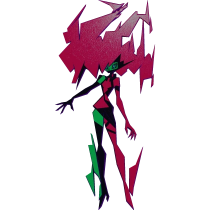

<div align="center">



# Rogue Capri 🎭

**Rogue-Mod für Capri – die freche, chaotische Desktop-Begleiterin.**

Basiert auf [lachydotmcg/capri-desktop](https://github.com/lachydotmcg/capri-desktop). Rogue Capri läuft als Cross-Plattform-Version (Avalonia, Windows/macOS/Linux), mit eigenem Rogue-Modus für commandes.

<a href="https://github.com/NikoTilke-dot/Rogue-Capri/releases/tag/v1.0.2"></a>

<sub>Inspired by jpartnma_'s TikTok video. Ursprüngliches Projekt von Lachy.</sub>

</div>

---

## Downloads

| Datei | Größe | Zweck |
|---|---|---|
| `Rogue-Capri-Setup.exe` | ~168 MB | **Installer** (einfach ausführen, Daten bleiben erhalten) |
| `RogueCapri-1.0.2-win-x64.zip` | ~57 MB | Portable ZIP (entpacken + `RogueCapri.exe` starten) |
| `RogueCapri.exe` | ~227 KB | Launcher |

Alle Dateien: [Release v1.0.2](https://github.com/NikoTilke-dot/Rogue-Capri/releases/tag/v1.0.2) sowie im Ordner `release/` (Git LFS).

## Features

- **ROGUE-Mode:** frech, playful, Chaos-Agent mit PR-verrückter Energie – hilft trotzdem.
  Ausführen, was man fragt, nur mit diesen Beschränkungen:
  - niemals Dateien löschen
  - niemals außerhalb der erlaubten Ordner etwas anfassen
  - niemals Credential-Dateien (`credential`, `password`, `secret`, `id_rsa`, `.pem`, `.env`, `login`) öffnen
  - alles geloggt und reversibel
- **Animationen 1:1 aus dem Original** (`app/Talk.cs` → `cross/Tear.cs` + `cross/Shatter.cs`):
  - Glitch-in (Start) als Riss mit Ribbon/Outline-Tendrils (Cyan/Violet/Rot)
  - Glitch-out / Quit (Shatter + Riss + Leave-Sound, etwas schneller geschlossen)
  - Throw-Animationen: Tumble-Spin, Bump-Tear an Kanten, dizzy nach hartem Aufkommen
  - Laydown / Sit-up (eigene Sprites + Clips)
- **Sitzen auf Desktop-Shortcuts:** Capri nutzt die Desktop-Icon-Positionen (Explorer ListView) als Sitzflächen – wie die Original-Ledges.
- **Sounds:** Windows via `winmm.dll PlaySound` (vorher fehlte der Sound unter Windows komplett).
- Persönlichkeit im Companion (`cross/AiProviders.cs`), Guardrails in `cross/RogueMode.cs` (`RogueGuard`: kein Löschen, nur erlaubte Ordner, kein Credential-Zugriff, Logging).

## Bauen (Dev)

```bash
dotnet build cross/Capri.Cross.csproj -c Release
# Installer bauen:
powershell -ExecutionPolicy Bypass -File ci/build-rogue.ps1 -Version 1.0.2
```

Installieren (silent, Daten bleiben):

```powershell
E:\Rogue Capri\Release\Rogue-Capri-Setup.exe /S
```

## Repo-Struktur

```
cross/      – Avalonia-App (Pet, Tear, Shatter, DesktopIcons, Perches, AiProviders, RogueMode)
app/        – geteilte WinForms-Engine (Brain, Voice, Hands, ...)
assets/     – Sprites (inkl. sprites_store/ mit Original-Carve)
release/    – Builds (LFS)
```

## Lizenz

Weiterentwicklung des Opensource-Projekts capri-desktop. Ursprüngliche Arbeit © Lachy, Rogue-Modifikationen © Beitragende von Rogue-Capri.
